# SimuLearn

> **Practice before it matters.**
> Simulations professionnelles vocales pour la formation en santé (IFSI, France) : l'apprenant parle à un patient IA, puis reçoit une évaluation argumentée, appuyée sur des extraits vérifiables de sa propre conversation.

[](https://github.com/yassineaqejjaj/simulearn/actions/workflows/ci.yml)


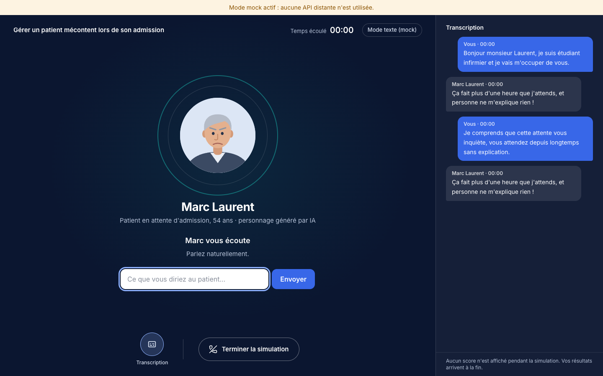

## Sommaire
1. [État du projet : à lire d'abord](#1-état-du-projet--à-lire-dabord)
2. [Partie fonctionnelle](#2-partie-fonctionnelle) — le produit, le parcours apprenant, l'espace formateur, l'évaluation
3. [Partie technique](#3-partie-technique) — architecture, données, voix, évaluation, sécurité, coûts, API
4. [Démarrer](#4-démarrer)
5. [Tests](#5-tests)
6. [Limites connues et suite](#6-limites-connues-et-suite)
7. [Documentation détaillée](#7-documentation-détaillée)

---

## 1. État du projet : à lire d'abord

SimuLearn est un **MVP**. Le parcours complet fonctionne de bout en bout avec des fournisseurs **simulés** (mode *mock*). Les intégrations réelles sont écrites d'après la documentation officielle, mais **n'ont pas pu être testées faute de clés d'API** au moment du développement.

| Élément | Statut |
|---|---|
| Parcours complet (connexion → simulation → évaluation → nouvelle tentative → comparaison) | ✅ Testé en mode mock (pytest, test e2e Playwright, parcours manuel) |
| Conversation vocale **OpenAI GPT-Live** (WebRTC + écoute serveur) | ⚠️ Écrite d'après la doc, **jamais exécutée contre le vrai service** |
| Évaluation **Anthropic Claude** | ⚠️ Appel écrit avec le SDK officiel, testé seulement avec un faux client |
| Authentification **Keycloak** | ⚠️ Vérification des jetons écrite, **jamais testée** contre une vraie instance |
| PostgreSQL et Docker Compose | ⚠️ Écrits, **non lancés** (les tests et la migration ont tourné sur SQLite) |
| Voix françaises `sillage` et `brise` | ❓ Absentes de la documentation consultée : disponibilité à vérifier sur votre compte |
| Revue juridique, sécurité, AIPD | ❌ À faire avant tout usage avec de vrais apprenants ou établissements |

> **Les captures d'écran de ce document ont été prises en mode mock** : la voix est remplacée par une saisie texte et l'évaluateur est une heuristique non pédagogique (marquée `[MOCK]`). Elles montrent l'interface, pas la qualité réelle des conversations ni des évaluations.

Les données sont **fictives** (personnages et situations). N'utilisez jamais de dossier patient réel.

---

## 2. Partie fonctionnelle

### 2.1 Le produit

Une formation classique repose sur des vidéos et des questionnaires. SimuLearn fait **pratiquer** : l'apprenant dialogue **à l'oral** avec un personnage IA (identité, personnalité, émotions, objectifs, mémoire de la conversation) qui réagit à ce qu'il dit. Il peut interrompre, se tromper, reformuler. À la fin, une évaluation par compétence est produite, avec les passages exacts de la conversation qui la justifient. Il peut recommencer et mesurer sa progression.

Principes de conception :
- **Practice first**, **Voice first** : la conversation vocale est l'expérience centrale.
- **Pédagogie avant le spectacle** : pas d'avatar 3D, une interface sobre et lisible.
- **Retour fondé sur des preuves** : aucune note sans citation vérifiable ; une compétence non observée reste « non évaluée ».
- **Le formateur garde la main** : il relit, corrige et commente, sans écraser la sortie de l'IA.
- **Pas de note globale** : chaque compétence est évaluée séparément. Les résultats sont un retour de formation, **pas une certification**.

### 2.2 Le premier scénario : « Gérer un patient mécontent lors de son admission »

Marc Laurent, 54 ans, attend depuis longtemps et estime manquer d'informations. Direct, impatient, inquiet, il se calme quand il se sent écouté (mais pas après une seule bonne réponse). L'étudiant infirmier doit : accueillir, identifier l'inquiétude, écouter sans couper, reconnaître le mécontentement, parler simplement, éviter les promesses non garanties, expliquer la suite dans les limites de son rôle, conclure avec respect.

La grille v1 évalue sept compétences, notées de 1 à 5 : qualité de l'accueil, écoute active, empathie, clarté des explications, gestion du mécontentement, respect et professionnalisme, conclusion de l'échange.

### 2.3 Parcours apprenant

**Tableau de bord** : simulation recommandée, progression (simulations terminées, temps de pratique, compétences évaluées), dernière évaluation, simulations récentes.

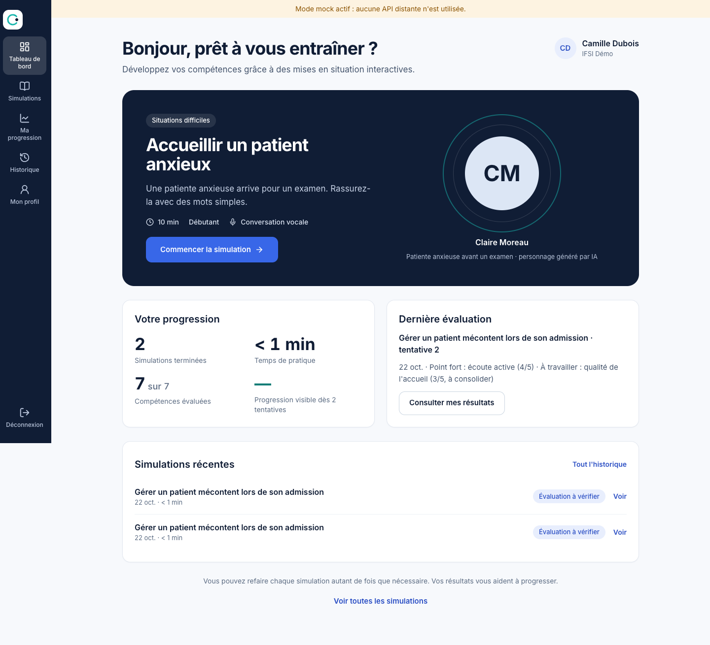

**Catalogue** : recherche et filtres par catégorie. **Fiche scénario** : situation, compétences travaillées, déroulé en trois étapes, historique des tentatives.

| Catalogue | Fiche scénario |
|---|---|
| 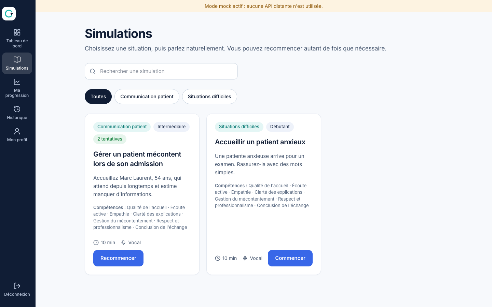 | 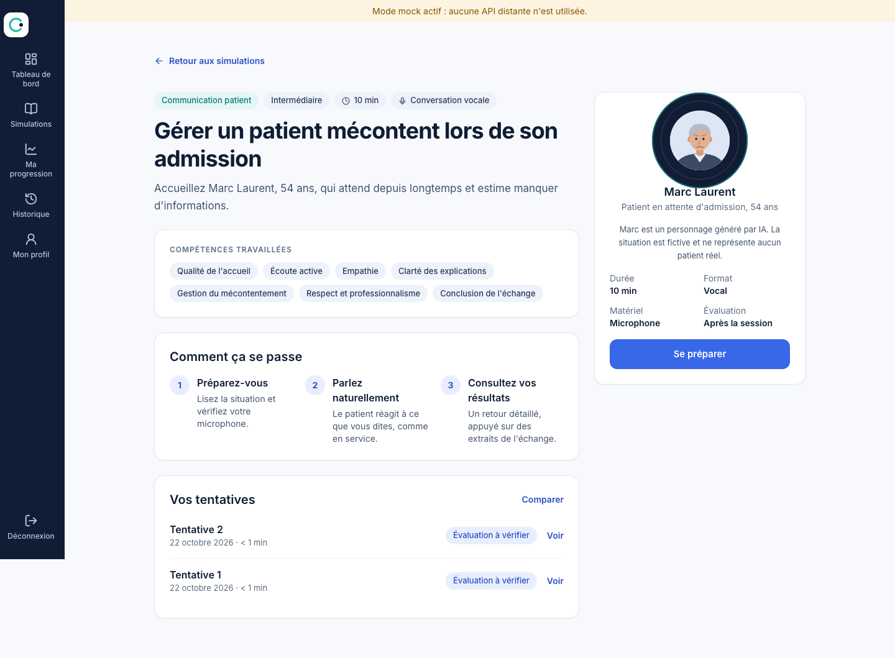 |

**Préparation** : lecture de la situation, rôle et objectifs, test du microphone avec niveau sonore réel, rappel clair du traitement des données.

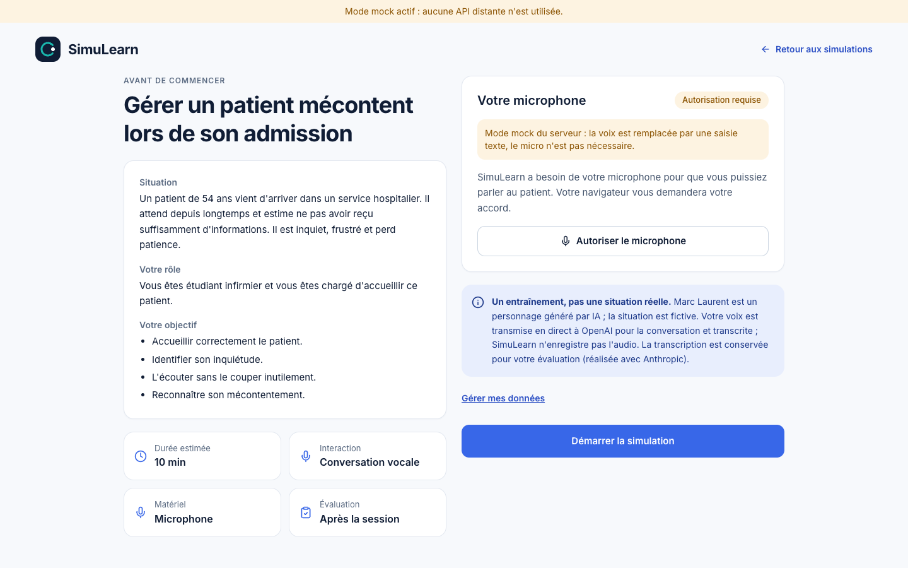

**Salle de simulation** : le patient réagit en direct ; l'état affiché (écoute, parole, réflexion, micro coupé, connexion interrompue) correspond à des événements réels, jamais à des délais simulés. Transcription facultative, aucun score pendant la session, réglages audio (micro, volume). La fin de session demande confirmation.

| Bureau | Fin de session | Mobile |
|---|---|---|
|  | 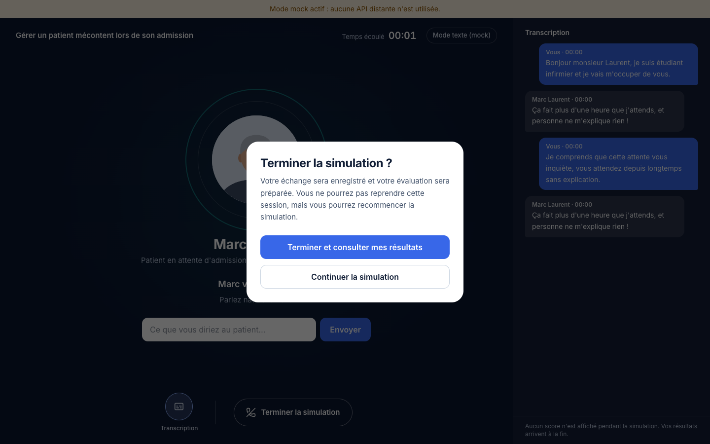 | 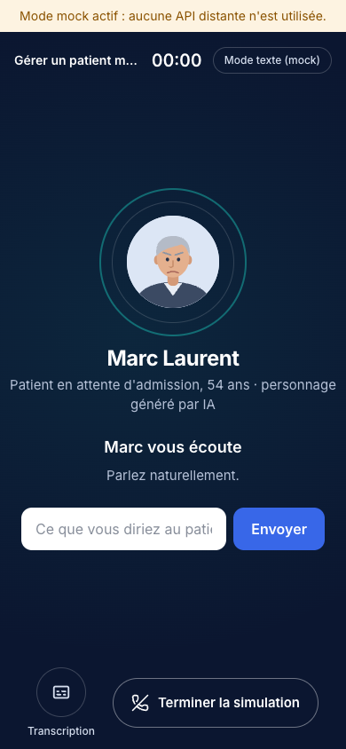 |

**Résultats** : un retour général, puis chaque compétence avec son niveau, sa justification, un **extrait de la conversation** et un conseil. Une compétence sans preuve suffisante apparaît en pointillés, « Non évalué », et n'est jamais remplacée par une note inventée.

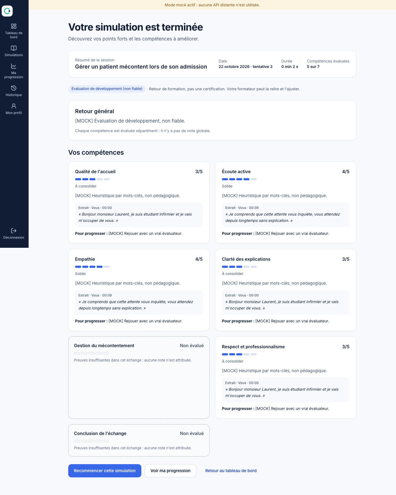

**Progression** : comparaison de deux tentatives **sur la même version de grille** (progrès, stable, non comparable), puis historique. Deux tentatives de grilles différentes ne sont jamais comparées directement.

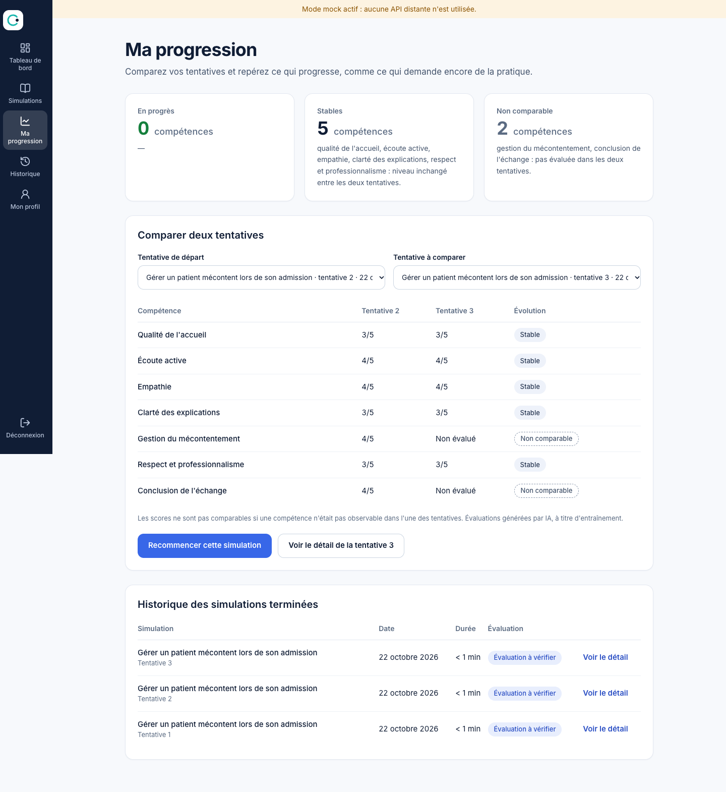

### 2.4 Espace formateur

Tableau de bord, liste des apprenants, des groupes (lecture seule), des sessions et des scénarios ; **création et modification de scénarios** par formulaires (une modification crée une **nouvelle version**, les sessions passées restent liées à l'ancienne) ; choix de la voix ; **relecture des évaluations** : correction d'un score et commentaires, stockés à part, la sortie initiale de l'IA reste intacte et consultable.

| Tableau de bord | Relecture d'une évaluation |
|---|---|
| 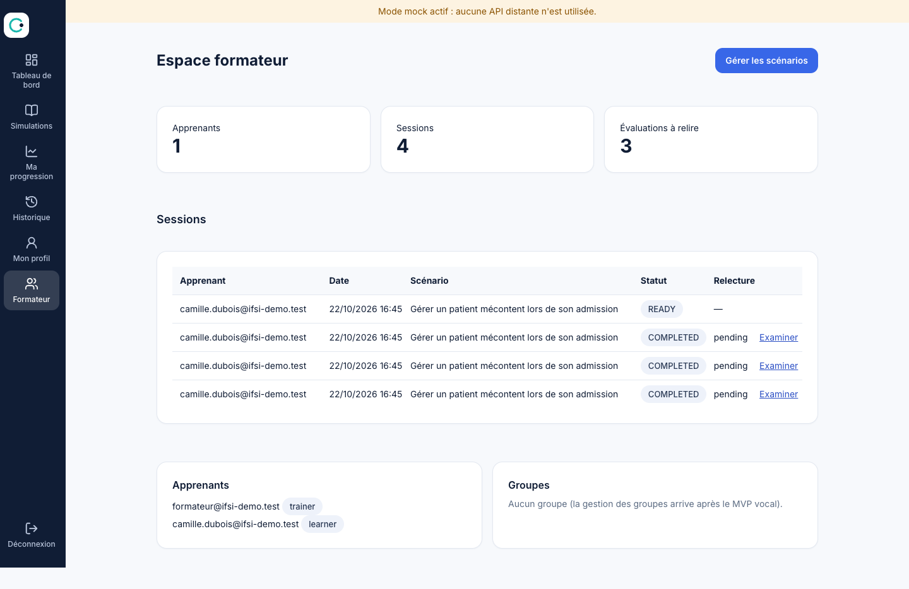 | 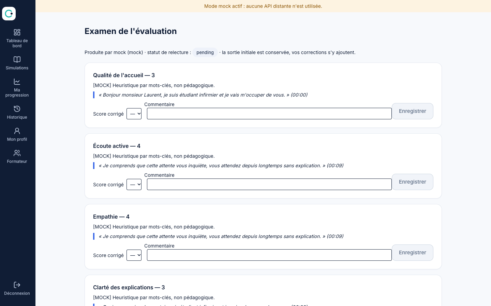 |

### 2.5 Données et vie privée (résumé)
- Aucun enregistrement audio par SimuLearn. La voix est transmise en direct à OpenAI pour la conversation et transcrite ; la transcription est conservée pour l'évaluation (réalisée avec Anthropic).
- L'apprenant peut **exporter** ses données et **supprimer** ses transcriptions et évaluations (page *Mon profil*). Durée de conservation configurable.
- Détail et obligations restantes : [docs/security.md](docs/security.md). Utiliser OpenAI et Anthropic **ne garantit pas** à lui seul la conformité RGPD.

---

## 3. Partie technique

### 3.1 Architecture

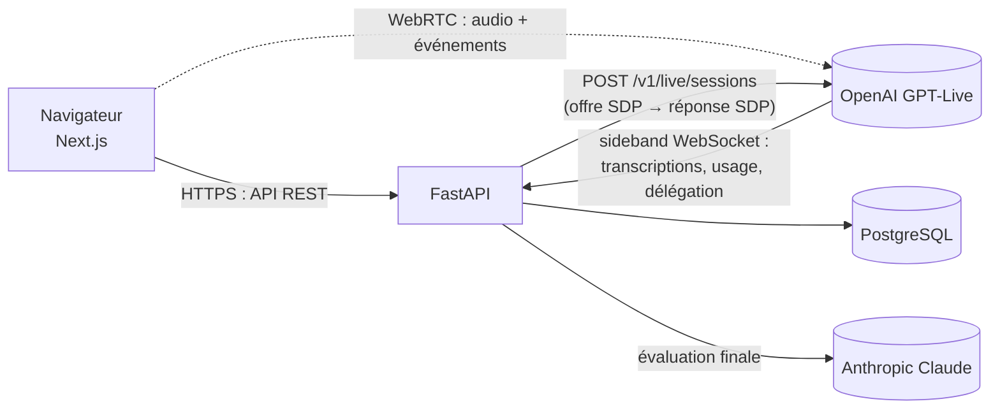

- **Le navigateur ne voit jamais la clé OpenAI** : il envoie son offre SDP à FastAPI, qui crée la session GPT-Live et renvoie la réponse. L'audio ne transite pas par FastAPI.
- **SimuLearn est la source de vérité.** Transcriptions et scores proviennent de l'écoute serveur (sideband), jamais du navigateur, qui ne peut poster que des événements d'interface (`client.*`). Sessions, versions de scénario, grilles et résultats sont gérés par l'application, pas par les API d'IA.
- **GPT-Live parle, Claude évalue.** Claude n'écrit pas les répliques du patient ; il n'est appelé qu'après la session.
- **Fournisseurs interchangeables** : le métier dépend d'interfaces (`VoiceSimulationProvider`, `EvaluationProvider`), pas des SDK. Implémentations : `OpenAILiveProvider`, `ClaudeEvaluationProvider`, et des variantes `mock`.

### 3.2 Stack

| Couche | Technologie |
|---|---|
| Frontend | Next.js 16, React 19, TypeScript strict, Tailwind CSS 4, TanStack Query, Lucide |
| Backend | Python 3.12, FastAPI, Pydantic v2, SQLAlchemy 2, Alembic |
| Base de données | PostgreSQL 17 (tests et dev rapide : SQLite) |
| Authentification | Keycloak (JWT RS256 via JWKS) ; mode dev explicite et désactivé par défaut |
| Voix | OpenAI `gpt-live-1` en WebRTC (+ sideband WebSocket côté serveur) |
| Évaluation | Anthropic `claude-sonnet-5-5`, sortie structurée via outil forcé |
| Cache | Valkey (déployé, **pas encore utilisé** par le code) |
| Déploiement | Docker Compose |
| Tests | pytest, Vitest, Playwright |

Composants applicatifs et d'infrastructure open source et auto-hébergeables ; seules dépendances externes obligatoires : OpenAI et Anthropic. Pas de moteur vectoriel, ni Kubernetes, ni framework multi-agent.

### 3.3 Structure du dépôt

```text
simulearn/
├── apps/
│   ├── api/                 FastAPI : app/ (code), alembic/ (migrations), config/pricing.json, tests/
│   │   └── app/
│   │       ├── models.py            schéma métier (22 tables)
│   │       ├── seed.py              grille v1 + scénario Marc Laurent
│   │       ├── prompts.py           prompt du personnage généré depuis la base
│   │       ├── emotion.py           état émotionnel interne (règles déterministes)
│   │       ├── transcript.py        regroupement des fragments en messages
│   │       ├── runtime.py           session vocale : événements, états, fin de session
│   │       ├── evaluation_service.py / evaluation_schema.py / evidence.py
│   │       ├── providers/           interfaces + OpenAI, Claude, mocks
│   │       └── routers/             scenarios, simulations, evaluations, trainer, privacy
│   └── web/                 Next.js : app/ (pages), components/, hooks/, lib/, e2e/
├── packages/shared/         réservé (vide pour l'instant)
├── infrastructure/
│   ├── docker/              realm Keycloak importable
│   └── scripts/             dev.sh, demo_data.py, screenshots.mjs
├── docs/                    architecture, database, voice-integration, evaluation, security, deployment, screenshots
├── docker-compose.yml
└── .env.example
```

### 3.4 Modèle de données

Principales entités : `organizations`, `users`, `memberships`, `groups`, `competency_frameworks` → `competencies` → `evaluation_criteria`, `scenarios` → `scenario_versions` → `characters`, `simulation_sessions`, `character_states` (journal émotionnel), `conversation_fragments` (brut) → `conversation_messages` (regroupé), `simulation_events`, `evaluations` → `evaluation_scores` → `evaluation_evidence`, `trainer_reviews`, `usage_metrics`, `audit_logs`.

Règles structurantes :
- **Versionnement** : une session pointe vers une `scenario_version`, une évaluation vers une version de grille. Aucun résultat historique n'est reconstruit depuis le dernier état.
- **Pas d'écrasement** : `evaluations.raw_output` conserve la sortie de Claude ; les corrections vivent dans `trainer_reviews`.
- **Isolation par organisation** : chaque requête filtre sur l'organisation du principal ; hors périmètre = `404` (l'existence n'est pas révélée).
- UUID partout, clés étrangères, index adaptés. Détails : [docs/database.md](docs/database.md).

### 3.5 Session vocale (GPT-Live)

1. `POST /api/simulations` crée la session métier (`CREATED`) après contrôle des quotas (une session simultanée par utilisateur, quota mensuel de l'organisation).
2. Le navigateur envoie son offre SDP à `POST /api/simulations/{id}/connect`. FastAPI génère les instructions du patient depuis la base, appelle `POST /v1/live/sessions` (modèle, voix, `delegation: client`, transport WebRTC) et renvoie la réponse SDP. Le navigateur ouvre le canal de données `oai-events`.
3. FastAPI ouvre le **sideband** `wss://…/v1/live/sessions/{id}/attach` et consomme, dans `runtime.py` : `session.started`, `session.input_transcript.delta`, `session.output_transcript.delta`, `session.usage.updated`, `session.delegation.created`, `session.closed`, `error`.
4. Les fragments de transcription sont ordonnés par `start_ms/end_ms` (jamais par ordre d'arrivée), puis regroupés par locuteur et proximité. Un passage interrompu ou incomplet est **marqué** (`reliability`), jamais présenté comme une preuve parfaite.
5. **États émotionnels** (frustration, confiance, inquiétude, coopération) : règles déterministes bornées 0-100 déclenchées par des signaux dans la parole de l'apprenant (empathie, reformulation, réponse sèche, prochaine étape crédible, jargon, promesse irréaliste). Seuls les signaux déclarés par le scénario sont acceptés ; les changements majeurs sont journalisés. Le contexte est transmis à GPT-Live par `session.thinking.append` (silencieux, sans interrompre la parole). Les valeurs ne sont jamais visibles de l'apprenant.
6. **Fin de session** : manuelle, durée maximale ou plafond de coût estimé. `session.close`, attente de `session.closed` (10 s, sinon transcription marquée incomplète), regroupement final, métriques d'usage, puis évaluation. Les durées vocales cumulatives ne sont **pas additionnées** : on retient la dernière valeur.

Points non validés sans clé OpenAI (voix françaises, interruptions, en-têtes éventuels, latences) : [docs/voice-integration.md](docs/voice-integration.md).

### 3.6 Évaluation

Pipeline de `evaluation_service.py` :
1. Entrée : version du scénario, objectifs, grille et descripteurs, messages (UUID, locuteur, horodatage, fiabilité), limites de transcription. **Aucune donnée d'identité** de l'apprenant.
2. Appel Claude avec sortie structurée forcée (schéma Pydantic). Le contenu des messages est traité comme une **donnée**, jamais comme une instruction (réduit le risque d'injection, ne l'élimine pas).
3. Validation : `observable=false` ⇒ `score=null` ; score de 1 à 5. En cas d'échec, jusqu'à 3 tentatives (l'erreur est renvoyée au modèle) ; sinon statut `failed`, visible et relançable. **Jamais d'évaluation partielle silencieuse.**
4. **Vérification déterministe des preuves** : le message existe, appartient à la session, le locuteur correspond, la citation figure dans le message (normalisation + tolérance). Une preuve rejetée est retirée et journalisée ; un score sans aucune preuve vérifiée est retiré. Les horodatages viennent de la base, jamais du modèle.
5. Pas de parole de l'apprenant ⇒ pas d'appel Claude. Transcription incomplète ⇒ évaluation avec avertissement.

### 3.7 Sécurité (résumé)
Clés API côté serveur uniquement ; contrôle d'accès par organisation et rôle sur chaque ressource ; aucune erreur fournisseur brute relayée ; journal d'audit ; export et suppression de données ; mode de connexion simulé refusé si `APP_ENV=production`. Ce qui reste à faire (limitation de débit, durcissement, HTTPS/WSS, revue juridique) : [docs/security.md](docs/security.md).

### 3.8 Coûts et performance
Chaque session enregistre sa durée vocale, ses tokens Claude, une estimation de coût, des métriques de latence (connexion, délai de réaction, interruptions) et les erreurs fournisseur. **Les tarifs ne sont pas codés en dur** : ils sont lus dans [`apps/api/config/pricing.json`](apps/api/config/pricing.json) (versionné). Le tarif de la voix y est renseigné ; **les tarifs Claude sont à `null`** : le coût est alors affiché « inconnu » plutôt qu'inventé. Aucune latence cible n'est revendiquée : elles ne sont mesurées qu'en conditions réelles.

### 3.9 Référence rapide de l'API

Documentation interactive : `GET /docs` (Swagger) sur l'API.

| Domaine | Endpoints |
|---|---|
| Santé | `GET /api/health` (état de configuration, jamais « connecté » sans clé) |
| Catalogue | `GET /api/scenarios`, `GET /api/scenarios/{id}` |
| Simulation | `POST /api/simulations`, `POST …/{id}/connect`, `POST …/{id}/end`, `POST …/{id}/client-events`, `GET /api/simulations`, `GET …/{id}`, `GET …/{id}/messages`, `GET …/{id}/costs` |
| Évaluation | `GET …/{id}/evaluation`, `POST …/{id}/evaluate` (relance), `GET /api/compare?a=&b=` |
| Profil et données | `GET /api/me`, `GET /api/me/export`, `DELETE /api/me/data` |
| Formateur | `/api/trainer/` : `dashboard`, `learners`, `groups`, `sessions`, `frameworks`, `voices`, `scenarios` (`GET`, `POST`, `PUT`), `evaluations/{id}` (`GET`), `evaluations/{id}/reviews` (`POST`) |
| Développement | `POST …/{id}/mock-turn` (uniquement si `VOICE_PROVIDER=mock`) |

### 3.10 Configuration

Toutes les variables sont dans [`.env.example`](.env.example). Principales :

| Variable | Rôle |
|---|---|
| `DATABASE_URL`, `POSTGRES_PASSWORD` | Base de données |
| `KEYCLOAK_URL`, `KEYCLOAK_REALM`, `KEYCLOAK_CLIENT_ID` | Authentification |
| `AUTH_DEV_MODE` | Connexion simulée (`dev:<email>:<rôle>`), **jamais en production** |
| `OPENAI_API_KEY`, `OPENAI_LIVE_MODEL`, `OPENAI_LIVE_VOICE`, `VOICE_PROVIDER` | Voix (`openai_live` ou `mock`) |
| `ANTHROPIC_API_KEY`, `ANTHROPIC_EVALUATION_MODEL`, `EVALUATION_PROVIDER` | Évaluation (`claude` ou `mock`) |
| `SIMULATION_MAX_DURATION_MINUTES`, `SIMULATION_MAX_CONCURRENT_PER_USER`, `MAX_SESSION_ESTIMATED_COST_USD`, `ORG_MONTHLY_SESSION_QUOTA` | Limites et quotas |
| `TRANSCRIPT_RETENTION_DAYS` | Rétention des contenus |

Une clé manquante n'est jamais masquée : `/api/health` la signale et l'interface affiche un bandeau explicite.

---

## 4. Démarrer

### Sans aucune clé (mode mock)
Prérequis : Python ≥ 3.11 avec [uv](https://docs.astral.sh/uv/), Node ≥ 22.

```bash
infrastructure/scripts/dev.sh
```
Ouvrez http://localhost:3000, connectez-vous (mode développement), lancez « Patient mécontent ». Si le port 8000 est pris : `API_PORT=8791 infrastructure/scripts/dev.sh`. Pour peupler des données de démonstration : `python3 infrastructure/scripts/demo_data.py http://127.0.0.1:8000`.

### Avec les vraies API
```bash
cp .env.example .env     # renseigner OPENAI_API_KEY, ANTHROPIC_API_KEY, VOICE_PROVIDER=openai_live, EVALUATION_PROVIDER=claude, Keycloak
docker compose up --build
```
Créez les utilisateurs et leurs rôles (`learner`, `trainer`, `admin`) dans Keycloak (realm `simulearn` importé) ; chaque compte doit aussi exister côté application avec une appartenance à un établissement (pas d'auto-provisionnement en mode Keycloak). Voir [docs/deployment.md](docs/deployment.md). Premier test recommandé : une session GPT-Live réelle, pour valider la création de session, la voix et les transcriptions.

### Régénérer les captures d'écran
Avec l'API et le site en mode mock lancés : `python3 infrastructure/scripts/demo_data.py <api>` puis `node infrastructure/scripts/screenshots.mjs` (utilise le Chrome installé).

---

## 5. Tests

| Suite | Commande | Contenu |
|---|---|---|
| API | `cd apps/api && uv sync --group dev && uv run pytest` | 40 tests : états de session, transcription, interruptions, perte de connexion, durée et coût maximaux, requête GPT-Live, validation et nouvelles tentatives d'évaluation, preuves, comparaison, correction formateur, isolation, export et suppression |
| Frontend | `cd apps/web && npm test && npm run typecheck` | 7 tests (formats, numérotation des tentatives, comparaison, recommandations) |
| Bout en bout | `cd apps/web && npx playwright test` | Parcours apprenant complet en mode mock, avec Chrome installé (serveurs lancés au préalable) |

Tous ces tests utilisent des fournisseurs simulés : **aucun appel payant, aucun réseau**. Ils ne prouvent donc pas le bon fonctionnement des intégrations OpenAI, Anthropic et Keycloak. Les tests réels, à n'activer qu'avec des clés valides et un budget explicite, restent à écrire. La CI GitHub exécute les suites API et frontend (typecheck, tests, build).

---

## 6. Limites connues et suite

- **Intégrations réelles à valider** (voix, interruptions, Claude, Keycloak, PostgreSQL) : voir §1.
- **Interruptions** : le serveur détecte les chevauchements de parole et les signale à l'évaluateur, mais ne contrôle pas la lecture audio ; « ne pas retenir comme entendus des propos non joués » n'est donc pas garanti.
- **Un seul worker API** : l'état des sessions vocales est en mémoire. Plusieurs workers exigent un état partagé (Valkey).
- **Reconnexion automatique** : une session vocale perdue ne reprend pas ; l'interface propose de terminer pour obtenir l'évaluation. Piste : nouvelle session avec la transcription en `input`.
- **Pas de modules de formation** ni de gestion des groupes (lecture seule), pas de bouton Pause.
- **Pilotage pédagogique par Claude en cours de conversation** et **assistance à la création de scénarios** : non implémentés ; le moteur fonctionne sans.
- **Accessibilité** : audit scripté du DOM (noms accessibles, titres, cibles, débordement), pas d'audit WCAG complet.
- Portrait illustré uniquement pour Marc Laurent (monogramme pour les autres personnages).
- Fournisseur alternatif ElevenLabs + Claude : prévu par l'interface, non implémenté.

## 7. Documentation détaillée
[Architecture](docs/architecture.md) · [Base de données](docs/database.md) · [Intégration vocale](docs/voice-integration.md) · [Évaluation](docs/evaluation.md) · [Sécurité et RGPD](docs/security.md) · [Déploiement](docs/deployment.md)

## Licence
Non définie à ce stade : sans licence explicite, tous droits réservés. À choisir avant toute ouverture du dépôt.
